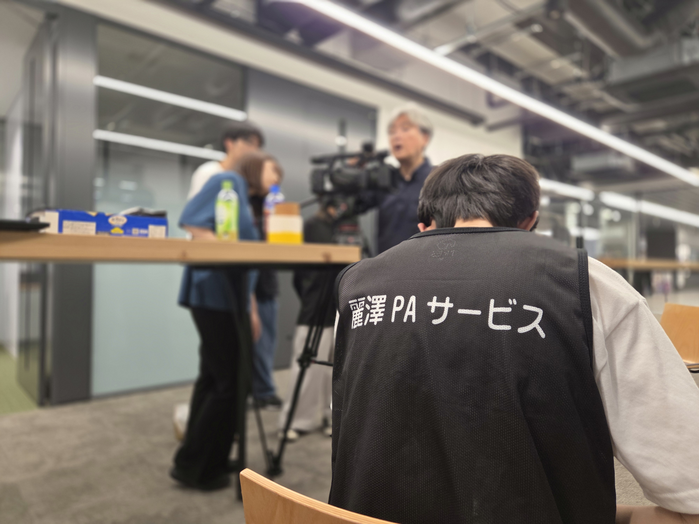

# site2026
2026/11/07作成
# 麗澤PAサービス Webサイト

スマートフォンに対応した、静的な日本語サイトです。HTML・CSS・JavaScriptだけで動作します。

## プレビュー

`index.html` をブラウザーで開くと表示できます。レイアウトやリンクを確認する場合は、フォルダー内の `index.html` をそのまま開いてください。Google Fontsの読み込みにはインターネット接続が必要です。

## 編集

- ページ構成・掲載文・外部リンク: `index.html`
- 色・文字・画面幅ごとのレイアウト: `styles.css`
- スマートフォンのナビゲーション: `script.js`

写真を掲載するには `assets` フォルダーを作成し、写真を `photo-01.jpg`、`photo-02.jpg`、`photo-03.jpg` として保存します。`index.html` のギャラリー内にある各 `.photo-placeholder` を、次のような画像要素に置き換えてください。

```html

```

追加写真はギャラリーの `<figure class="gallery-item">` を複製して掲載できます。写真の公開許可を確認してから追加してください。

## 公開

このサイトはビルド不要です。`index.html`、`styles.css`、`script.js` と `assets`（写真を使う場合）を同じ公開フォルダーに置いてください。

### GitHub Pages

1. サイト一式をGitHubリポジトリにアップロードします。
2. リポジトリの **Settings → Pages** を開き、公開元に `main` ブランチとルートフォルダーを選んで保存します。
3. 表示されたURLで公開結果を確認します。

### Netlify Drop

1. サイトファイルをひとつのフォルダーにまとめます。
2. Netlify Dropにフォルダーをアップロードします。
3. 発行されたURLを開いて表示を確認します。

## 掲載内容の更新メモ

- 連絡先はメールリンクに設定済みです。
- Slackは「麗澤大学工学部 Slack / #2-麗澤paサービス」と案内しています。SlackのワークスペースURLは提供されていないため、リンクは追加していません。
- Google Chatは利用歓迎の案内を掲載しています。専用URLは提供されていないため、リンクは追加していません。
- Instagram・YouTubeのリンクは依頼時に提供されたURLを設定しています。
- 活動写真は未提供のため、イベント写真に見せかけた画像は入れていません。
